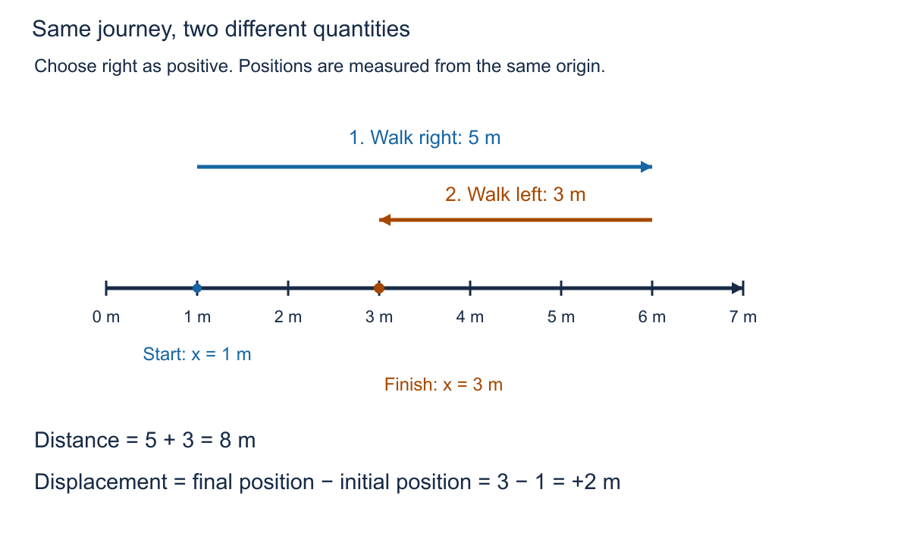
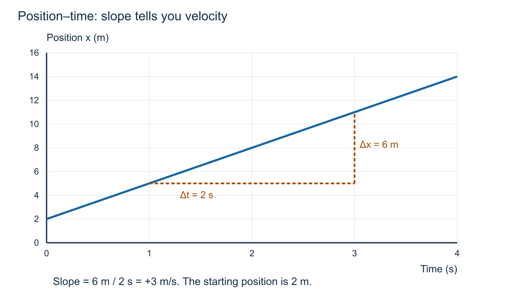
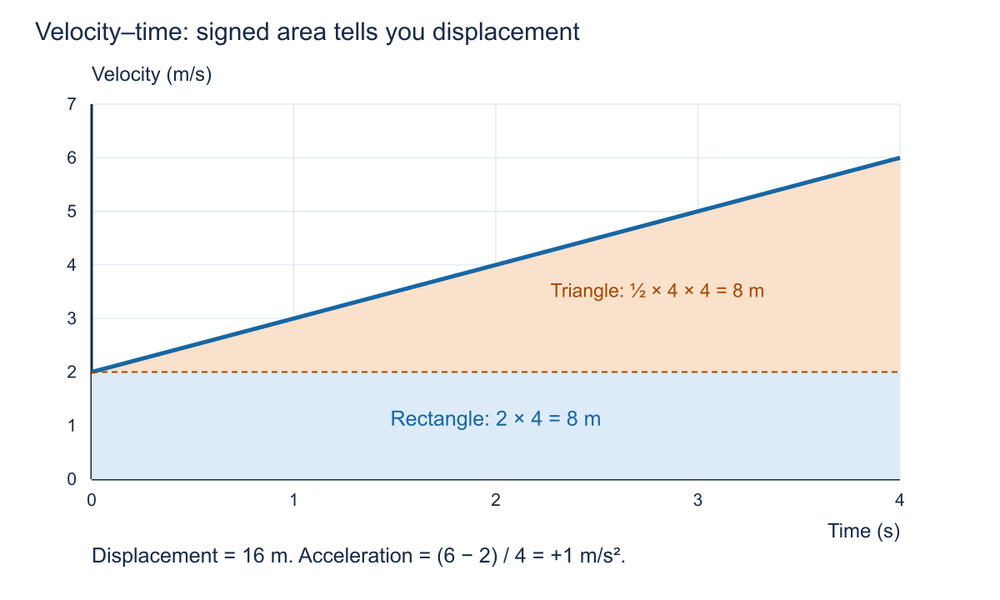
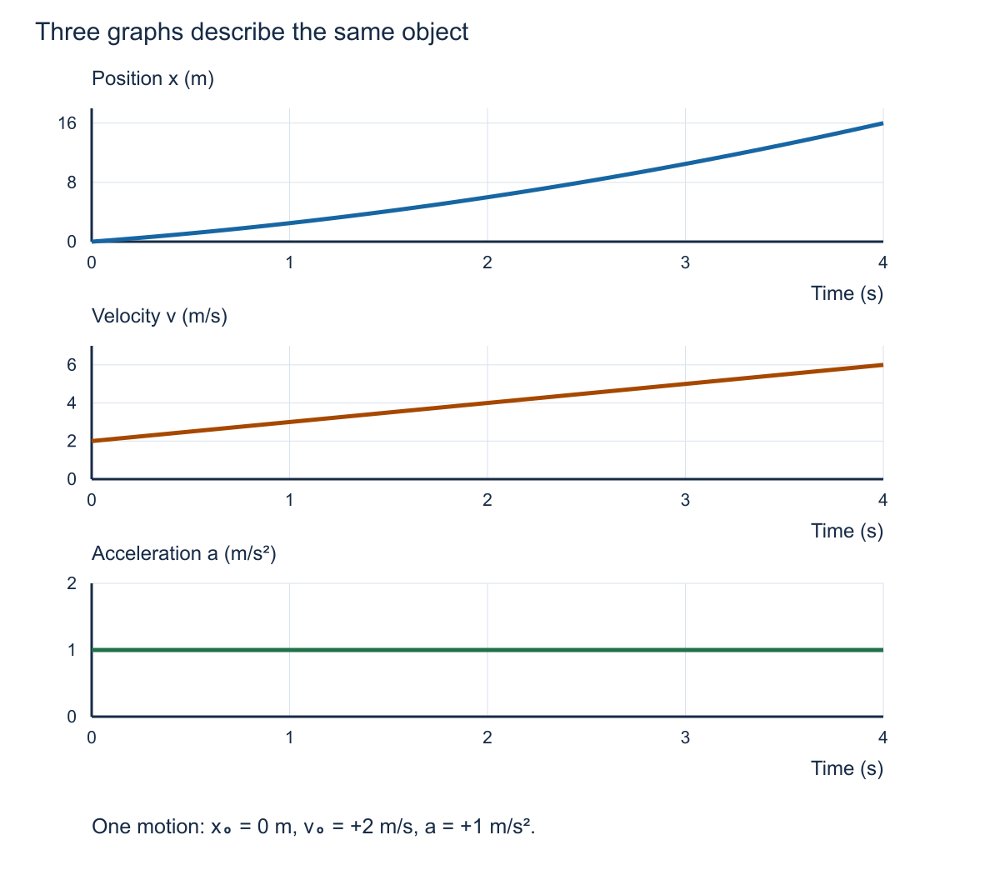
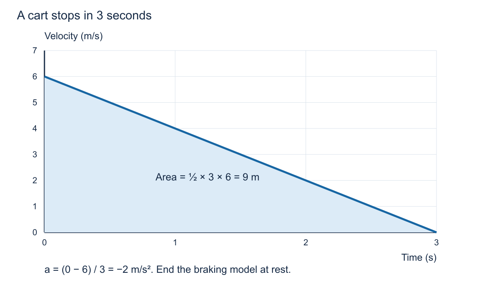
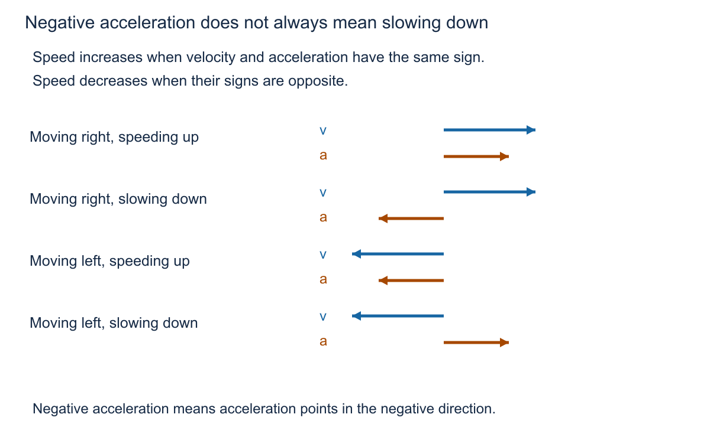
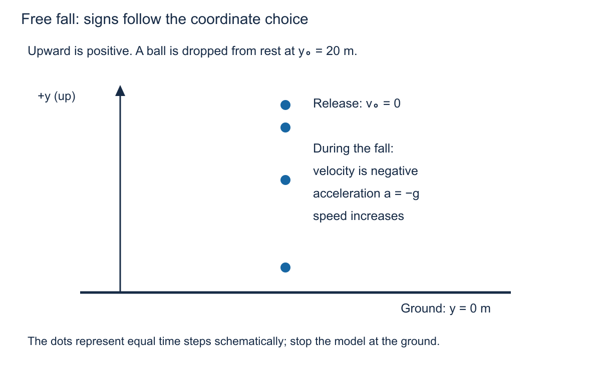

# Class 2 lecture: describing motion in one dimension

**Duration:** 90 minutes, including a five-minute break.  
**Starting point:** units and conversions from class 1.  
**You need:** paper, a pen, and a calculator for today's practice.

## What you will learn

By the end of this class, you should be able to distinguish distance from displacement and speed from velocity; read slopes and areas on motion graphs; and solve a constant-acceleration problem with a clear written method. These are skills for the final written exam. Its calculator and formula-sheet rules have not yet been confirmed.

We describe one point-like object moving along one straight line. Choose a positive direction before assigning signs. Our examples use metres, seconds, metres per second, and metres per second squared.

## 0–10 minutes | From units to motion

### Retrieval: write before discussing

1. Convert 72 km/h to m/s, showing cancellation of units.
2. Convert 250 ms to s.
3. If an object moves 12 m in 3 s, what are the units of 12 / 3?

**Check:** 72 × 1000 / 3600 = **20 m/s**; 250 × 0.001 = **0.250 s**; distance divided by time has units **m/s**.

A robot reporting a position of 12 m has not yet told us how quickly it moves. We need to know how its position changes with time. The same idea describes a game character, a lift, or a cart on a straight track.

### A method that makes your reasoning visible

1. List what is given, with units; identify the unknown.
2. Sketch the motion and choose the positive direction.
3. Convert to consistent units.
4. Choose an equation and rearrange it before substituting where practical.
5. Substitute values with their signs and units.
6. State the answer, round at the end, and check whether it makes sense.

## 10–25 minutes | Where is it, and how far did it move?

### Position, displacement, and distance

**Position x** tells us where the object is relative to an origin. The origin is our chosen zero. **Displacement Δx** is the change in position:

> Δx = x_final − x_initial

The symbol Δ means “change in.” Displacement can be positive, negative, or zero. **Distance** is the total length of the path travelled and cannot be negative.

*Figure 1. The origin and positive direction stay fixed throughout the journey.*

Suppose the journey takes 4 s in total:

- Average speed = total distance / total elapsed time = 8 m / 4 s = **2 m/s**.
- Average velocity = displacement / total elapsed time = +2 m / 4 s = **+0.5 m/s**.

Average speed and average velocity answer different questions. A return to the starting point gives zero displacement even though the object has travelled a nonzero distance.

| Quantity | What it describes | SI unit | Can it be negative? |
|---|---|---|---|
| Position x | Location relative to the origin | m | Yes |
| Displacement Δx | Final position minus initial position | m | Yes |
| Distance | Total path length | m | No |
| Velocity v | Rate of change of position, with direction | m/s | Yes |
| Speed | Magnitude of velocity | m/s | No |

**Pause and predict:** a delivery robot moves 5 m right and then 5 m left in 10 s. Find distance, displacement, average speed, and average velocity.

**Check:** 10 m; 0 m; 1 m/s; 0 m/s. Zero average velocity does not mean it stayed still.

**Unequal time intervals:** a cyclist travels in the positive direction at 12 m/s for 60 s and 16 m/s for 120 s. Its displacement is 12 × 60 + 16 × 120 = 2640 m. Its average velocity is 2640 / 180 = **14.7 m/s**, to three significant figures. The simple mean, 14 m/s, is wrong because the cyclist spends unequal times at the two speeds.

## 25–45 minutes | Read the axes before reading the graph

### Position–time graphs: velocity is the slope

*Figure 2. The graph is a plot of position against time, not a picture of a hill.*

Use two points on the line: at 1 s, x = 5 m; at 3 s, x = 11 m.

> Average velocity = Δx / Δt = (11 − 5) m / (3 − 1) s = **+3 m/s**.

The straight line has the same slope everywhere, so velocity is constant. The initial position is 2 m, the position at 4 s is 14 m, and the displacement over those 4 s is 12 m.

For constant velocity:

> x = x₀ + vt

Here x₀ is the position at the start of the time interval. The elapsed time t is measured from that start.

- An upward slope means positive velocity.
- A downward slope means negative velocity.
- A horizontal line means the position is not changing: the object is at rest.
- A steeper slope means a greater speed, whether the line rises or falls.

On a curved position–time graph, velocity changes. Average velocity comes from the line joining two points. Velocity at one instant comes from the local slope, pictured by a tangent touching the curve. We will read this idea visually; you do not need differentiation today. The supplied formula sheet writes instantaneous velocity as dx/dt.

**Check:** an object stays at x = 5 m for 3 s. Is its velocity 5 m/s? **No: the position graph is horizontal, so velocity is zero.**

### Velocity–time graphs: acceleration is the slope

Acceleration tells us how rapidly velocity changes:

> Average acceleration a = (v_final − v_initial) / Δt

Its SI unit is **m/s²**. An acceleration of +1 m/s² means the velocity increases by +1 m/s each second. This is a rate of change of velocity, not a distance.

*Figure 3. The slope measures acceleration; the shaded area measures displacement.*

The acceleration here is (6 − 2) m/s / 4 s = **+1 m/s²**.

A horizontal velocity graph means **constant velocity**, which need not be zero. Contrast this with a horizontal position graph.

### Velocity–time graphs: area is displacement

For constant velocity, displacement = velocity × elapsed time. On a velocity–time graph this is a rectangle's area.

For the rising straight line in Figure 3, split the area into simple shapes:

- Rectangle: 2 m/s × 4 s = 8 m.
- Triangle: ½ × 4 s × (6 − 2) m/s = 8 m.
- Total displacement: **16 m**.

The area units are (m/s) × s = m. Area below the time axis contributes **negative displacement**. To find total distance, add the magnitudes of the areas on either side of the axis.

**One-minute check:** what does a velocity–time line below the axis mean? **Motion in the negative direction.** It does not, by itself, tell you whether speed is increasing or decreasing.

## 45–50 minutes | Break

## 50–70 minutes | A constant-acceleration model

### Connect three descriptions

*Figure 4. All three graphs describe x₀ = 0 m, v₀ = +2 m/s, a = +1 m/s² over 0–4 s.*

| Time t (s) | Position x (m) | Velocity v (m/s) | Acceleration a (m/s²) |
|---|---|---|---|
| 0 | 0 | 2 | 1 |
| 1 | 2.5 | 3 | 1 |
| 2 | 6 | 4 | 1 |
| 3 | 10.5 | 5 | 1 |
| 4 | 16 | 6 | 1 |

Equal time steps give equal **changes in velocity**. The changes in position grow because the object moves faster as time passes.

### Equations and when they apply

The first four equations below require constant acceleration over the chosen interval. The final line relates position and displacement and is always true:

| Equation | Useful when… |
|---|---|
| v = v₀ + at | Linking velocity change and elapsed time |
| Δx = v₀t + ½at² | Finding displacement from initial velocity, acceleration, and time |
| Δx = ½(v₀ + v)t | Both endpoint velocities and time are known |
| v² = v₀² + 2aΔx | Time is not given or not needed |
| x = x₀ + Δx | Converting displacement into a final position |

The subscript 0 means “at the start of this interval,” not necessarily zero. Use **Δx** for displacement even when a source uses x with the starting position chosen as zero.

Why the first two equations work: rearranging a = (v − v₀) / t gives v = v₀ + at. The displacement is the rectangle v₀t plus the triangle ½ × t × at under the straight velocity line: Δx = v₀t + ½at². This explains why the time is squared.

**Unit check:** (m/s²) × s² = m, so ½at² has the units of displacement. A term ½at would have units of velocity and could not be added to v₀t.

The average of the endpoint velocities gives the average velocity only for constant acceleration. Do not apply that shortcut to an arbitrary motion graph.

### Worked example: stopping a cart

A cart moves right at 6.0 m/s and reaches rest in 3.0 s under constant acceleration. Find its acceleration and displacement.

**1. Givens and direction:** right is positive; v₀ = +6.0 m/s; v = 0; t = 3.0 s.

**2. Rearrange and calculate acceleration:**

> v = v₀ + at  
> a = (v − v₀) / t  
> a = (0 − 6.0) / 3.0 = **−2.0 m/s²**

**3. Find displacement:**

> Δx = ½(v₀ + v)t  
> Δx = ½(6.0 + 0) × 3.0 = **9.0 m**

**4. Check:** the displacement is positive because the cart keeps moving right until it stops. Constant deceleration gives an average velocity of 3.0 m/s, so 3.0 × 3.0 = 9.0 m agrees.

*Figure 5. This braking model ends when the cart reaches rest.*

If we keep applying the same negative acceleration beyond 3 s, the equation predicts motion to the left. It would no longer describe a cart that stops and remains parked.

**If time is missing:** the same cart has v₀ = 6.0 m/s, v = 0, and a = −2.0 m/s². Rearrange v² = v₀² + 2aΔx to get Δx = (v² − v₀²) / (2a) = (0 − 36) / (−4.0) = **9.0 m**.

## 70–85 minutes | Predict signs, then calculate

### Negative acceleration does not always mean slowing down

*Figure 6. Compare the signs of velocity and acceleration, rather than acceleration alone.*

At a turning point, instantaneous velocity can be zero while acceleration remains nonzero. A thrown ball at its highest point is an example.

### Guided attempt: a small robot

A robot starts at x₀ = 1.0 m with v₀ = +2.0 m/s. Its constant acceleration is +0.50 m/s² for 4.0 s. Find final velocity, displacement, and final position. Write the three requested quantities separately.

**Work individually for three minutes, compare with a partner for one minute, then check:**

> v = 2.0 + 0.50 × 4.0 = **4.0 m/s**  
> Δx = 2.0 × 4.0 + ½ × 0.50 × 4.0² = **12 m**  
> x = 1.0 + 12 = **13 m**

Its velocity increases from 2.0 to 4.0 m/s. Average velocity is 3.0 m/s, giving 3.0 × 4.0 = 12 m. The final position is not the same quantity as displacement.

### Free fall is a constant-acceleration example

Near Earth's surface, model a falling object with constant gravitational acceleration of magnitude **g = 9.81 m/s²**, neglecting air resistance. With upward positive, **a = −g**.

*Figure 7. The coordinate choice determines the signs; speed is a nonnegative magnitude.*

For a ball dropped from rest at y₀ = 20 m:

> v₀ = 0; a = −9.81 m/s²  
> At t = 1.0 s: v = 0 − 9.81 × 1.0 = **−9.81 m/s**  
> Δy = ½ × (−9.81) × 1.0² = **−4.905 m**  
> y = 20 − 4.905 = **15.095 m**, or about **15.1 m**

The ball is still above the ground, moving downward at a speed of about 9.81 m/s. Its positive height does not make its velocity positive. Stop this model at ground contact; it does not describe bouncing.

## 85–90 minutes | Check before the workshop

Answer without opening your notes, then discuss:

1. An object moves at a constant velocity of −3 m/s. What is its acceleration? **0 m/s².**
2. What does the slope of a velocity–time graph give? **Acceleration.**
3. What does its signed area give? **Displacement.**
4. Can velocity be zero while acceleration is nonzero? **Yes, for example at a turning point.**
5. Why must you convert km/h before using seconds and metres in a calculation? **The units must be consistent.**

Begin the [student workshop](workshop.md). Keep each handwritten attempt: the method and explanation matter as well as the number.

## Source connections

This lesson develops the supplied [lecture notes, pages 2–8](../course/reference/Physics%20Period1%20Lect%20%282%29.pdf) and the [orientation formula sheet, sections 0.1–0.3](../course/reference/PhysicsOrientationFormulas.pdf). The unequal-time cyclist example comes from [Review Exercise 3](../course/exercises/Physics%20Period1%20ReviewExer.pdf). New graphs and worked examples make the methods explicit. The original exercise numbering is retained when a question is reused.
