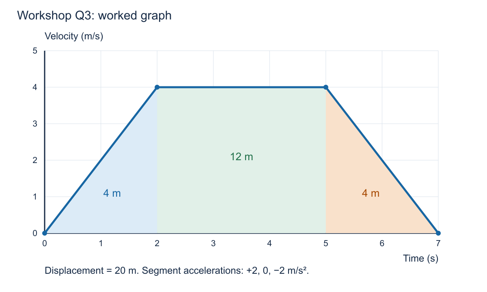
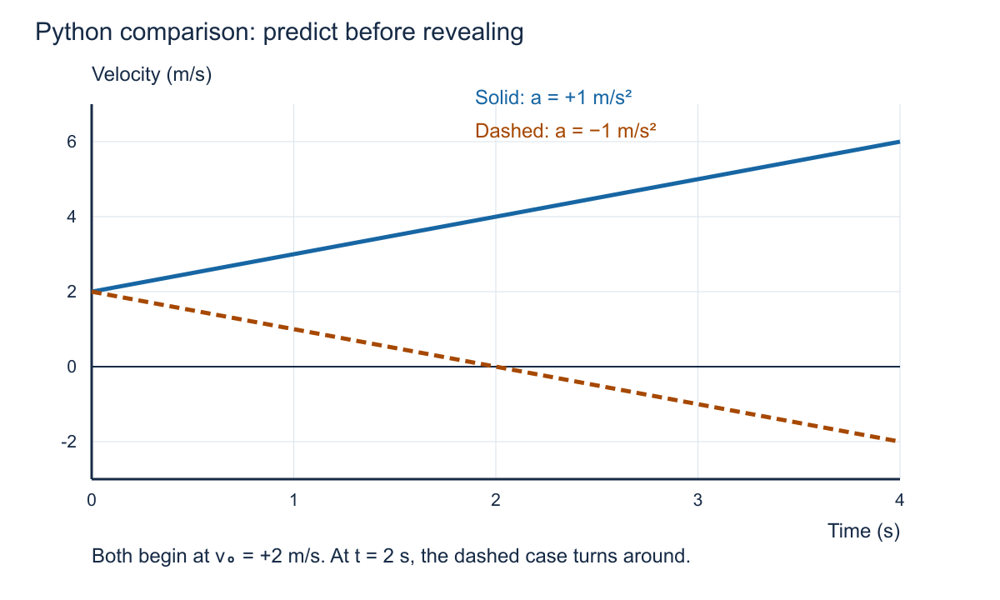

# Class 2 worked solutions

**Teacher copy — release after students have attempted the workshop.**

These are solutions to [the class 2 workshop](workshop.md). Marks below are a suggested formative rubric, not official course assessment rules. Accept equivalent methods and consistent alternative coordinate choices. Award credit for correct reasoning after an earlier arithmetic error; avoid repeatedly penalising the same error.

Graph coordinates are exact model values. For other calculated results, use three significant figures as today's working convention, keeping extra digits until the end. Accept sensible alternative rounding and do not turn this introductory motion lesson into a precision exercise.

## Q1. Units

**a.** 54 km/h × (1000 m / 1 km) × (1 h / 3600 s) = **15 m/s**. Kilometres and hours cancel.

**b.** 500 ms × (1 s / 1000 ms) = **0.500 s**.

**c.** Acceleration has units **m/s²**. An acceleration of +2 m/s² means velocity changes by +2 m/s each second. It does not mean the object necessarily moves 2 m each second, nor that its speed always increases.

**Listen for:** a student using m/s for both velocity and acceleration, or multiplying km/h by 3.6 instead of dividing.

## Q2. Robot journey

**a.** Start x = −2 m → move right 6 m to x = +4 m → move left 2 m to x = +2 m. Draw the origin at zero and keep right positive.

**b.**

> Final position = −2 + 6 − 2 = **+2 m**  
> Distance = 6 + 2 = **8 m**  
> Displacement = x_final − x_initial = 2 − (−2) = **+4 m**

**c.**

> Average speed = 8 m / 8 s = **1 m/s**  
> Average velocity = +4 m / 8 s = **+0.5 m/s**

**d.** The return segment adds to distance but subtracts from displacement. The total elapsed time is the same in both averages.

**Common error:** reporting 2 m as displacement because it is the final position. Ask the student to write both endpoint positions.

## Q3. Velocity–time graph



*All velocities are nonnegative. The shaded signed area therefore equals total distance here.*

**a–b. Motion and acceleration**

| Interval | Description | Slope calculation | Acceleration |
|---|---|---|---|
| 0–2 s | Moves right and speeds up from rest | (4 − 0) / (2 − 0) | **+2 m/s²** |
| 2–5 s | Moves right at constant velocity | (4 − 4) / (5 − 2) | **0 m/s²** |
| 5–7 s | Moves right and slows to rest | (0 − 4) / (7 − 5) | **−2 m/s²** |

The object does not move left in the final interval: its velocity remains positive until reaching zero.

**c. Displacement**

> First triangle = ½ × 2 s × 4 m/s = 4 m  
> Rectangle = 3 s × 4 m/s = 12 m  
> Last triangle = ½ × 2 s × 4 m/s = 4 m  
> Total Δx = 4 + 12 + 4 = **20 m**

**d.** Distance is **20 m**, equal to the positive displacement because there is no reversal of direction.

**e.** Average acceleration over the whole interval is (0 − 0) / 7 = **0 m/s²**. Initial and final velocities match, but velocity changes in between. Zero average acceleration does not imply zero acceleration at every instant.

**f.** At t = 1 s the graph's slope is **+2 m/s²**. At t = 3 s it is **0 m/s²**. Do not use the graph's height as acceleration.

**Early-finisher answer:** average velocity = 20 / 7 = **2.86 m/s**. The endpoint mean (0 + 0) / 2 is inappropriate because acceleration is not constant across the whole journey.

**Teacher detail:** the idealised graph has sharp corners at 2 s and 5 s, so a single instantaneous acceleration is not defined at those exact corners. The questions deliberately use times inside straight segments.

## Q4. Position–time graph

**a.** Label horizontal axis t (s), vertical axis x (m); plot (0, −1), (1, 2), (2, 5), and (3, 8). Join with one straight rising line. It crosses x = 0 at t = 1/3 s.

**b.**

> v = Δx / Δt = [8 − (−1)] / (3 − 0) = **+3 m/s**

Any pair of different points gives the same slope.

**c.** At 2 s, **position x = 5 m**, while **displacement Δx = 5 − (−1) = +6 m**.

**d.** The velocity graph is a horizontal line at **+3 m/s** from 0 to 3 s. Label both axes and units.

**e.** The position graph's height is position, with units m. Its slope has units m/s and gives velocity. Here the speed is **3 m/s**, not 5 m/s.

## Q5. Accelerating robot

Take right as positive: x₀ = 2.0 m, v₀ = +1.0 m/s, a = +0.80 m/s², t = 5.0 s.

**a.**

> v = v₀ + at  
> v = 1.0 + 0.80 × 5.0 = **+5.00 m/s**

**b.**

> Δx = v₀t + ½at²  
> Δx = 1.0 × 5.0 + ½ × 0.80 × 5.0²  
> Δx = 5.0 + 10.0 = **+15.0 m**  
> x = x₀ + Δx = 2.0 + 15.0 = **17.0 m**

**c.**

> Average velocity = ½(v₀ + v) = ½(1.0 + 5.0) = 3.0 m/s  
> Δx = 3.0 × 5.0 = **15.0 m**

The endpoint-average shortcut is valid because acceleration is constant throughout the interval.

**d.**

| Graph | Starting value | Ending value at 5 s | Shape |
|---|---|---|---|
| Position–time | 2 m | 17 m | Increasing curve, becoming steeper |
| Velocity–time | +1 m/s | +5 m/s | Rising straight line |
| Acceleration–time | +0.80 m/s² | +0.80 m/s² | Horizontal positive line |

The position curve has a positive initial slope; it does not start flat.

## Q6. Aircraft stopping model

**a. Convert first**

> v₀ = 220 km/h × (1000 m / 1 km) × (1 h / 3600 s)  
> v₀ = **61.111111… m/s**

Retain the unrounded value in calculations. The final velocity is v = 0 and elapsed time is 29 s.

**b. Acceleration**

> a = (v − v₀) / t  
> a = (0 − 61.111111…) / 29  
> a = −2.10727969… m/s² ≈ **−2.11 m/s²**

**c. Stopping displacement**

> Δx = ½(v₀ + v)t  
> Δx = ½(61.111111… + 0) × 29  
> Δx = 886.111111… m ≈ **886 m**

Alternatively, Δx = v₀t + ½at² gives the same result when the unrounded values are used.

**d. Graph check**

Draw a straight line from (0 s, 61.111… m/s) to (29 s, 0 m/s). Its triangular area is ½ × 29 × 61.111… = **886.111… m**.

**e. Interpretation**

Velocity remains positive during braking, so displacement is positive. Velocity decreases, giving a negative acceleration. Extending that constant negative acceleration beyond 29 s would predict a reversal; it would not model an aircraft remaining at rest.

The answer is the stopping displacement under the given constant-acceleration model, not a complete practical runway requirement. No additional real-world assumptions need to be calculated in this exercise.

## Q7. Beginner Python activity

### First run: a = +1 m/s², t = 4 s

> v = 2 + 1 × 4 = **6 m/s**  
> Δx = 2 × 4 + ½ × 1 × 4² = **16 m**  
> x = 0 + 16 = **16 m**

Expected output:

```text
Velocity (m/s): 6.0
Displacement (m): 16.0
Position (m): 16.0
```

### Second run: a = −1 m/s², t = 4 s

> v = 2 − 4 = **−2 m/s**  
> Δx = 2 × 4 − ½ × 4² = **0 m**  
> x = **0 m**

Expected output:

```text
Velocity (m/s): -2.0
Displacement (m): 0.0
Position (m): 0.0
```

### Third run: a = −1 m/s², t = 2 s

> v = 2 − 2 = **0 m/s**  
> Δx = 2 × 2 − ½ × 2² = **2 m**  
> x = **2 m**

Expected output:

```text
Velocity (m/s): 0.0
Displacement (m): 2.0
Position (m): 2.0
```



*Reveal this comparison only after students have made their predictions.*

**c.** In the negative-acceleration case, the object moves right and slows during 0–2 s. At 2 s it is instantaneously at rest. During 2–4 s it moves left and speeds up. Acceleration remains −1 m/s², including at the turn.

**d.** It travels 2 m right and then 2 m left. Displacement is 0 m, but distance is 4 m. The script calculates displacement, not total distance for a motion with reversal.

**Teaching check:** ask students to explain why the time is squared. Do not make successful typing or Python syntax recall the learning outcome.

## Q8. Independent written practice

Right is positive. Givens: v₀ = 54 km/h; v = 0; t = 5.0 s; x₀ = 10 m. Constant acceleration is assumed.

**a.** v₀ = 54 × 1000 / 3600 = **15 m/s**.

**b.**

> a = (v − v₀) / t = (0 − 15) / 5.0 = **−3.00 m/s²**

**c.**

> Δx = ½(v₀ + v)t = ½(15 + 0) × 5.0 = **37.5 m**  
> x = x₀ + Δx = 10 + 37.5 = **47.5 m**

Using Δx = v₀t + ½at² gives 75 − 37.5 = 37.5 m.

**d.** Draw a straight velocity line from (0 s, 15 m/s) to (5 s, 0 m/s). Label axes t (s) and v (m/s). Its area is ½ × 5 × 15 = **37.5 m**, agreeing with the displacement.

**e.** Accept an explicit constant-acceleration assumption, motion along a straight line, or braking starting at the stated initial time. The main equation restriction is constant acceleration.

### Suggested 10-mark formative rubric

| Evidence | Marks |
|---|---:|
| Converts 54 km/h to 15 m/s with a valid factor or unit method | 1 |
| Writes or rearranges a = (v − v₀) / t | 1 |
| Correct signed acceleration with m/s² | 1 |
| Chooses and substitutes into a valid displacement equation | 1 |
| Correct displacement with m | 1 |
| Adds the starting position to obtain 47.5 m | 1 |
| Graph has correctly labelled axes and units | 1 |
| Graph is straight with correct endpoints | 1 |
| Shows triangular area and agreement with displacement | 1 |
| States a valid model assumption | 1 |
| **Total** | **10** |

Allow follow-through for one conversion error when subsequent equations and signs are consistent. A final number alone does not demonstrate the method marks. Use the score to identify practice needs; do not convert it into an official course grade.

## Exit ticket

1. Slope gives **acceleration**; signed area gives **displacement**.
2. The object is **speeding up in the negative direction** because velocity and acceleration have the same sign. Its velocity becomes more negative, and its speed increases.
3. Accept a specific action, such as writing a positive direction, converting units first, rearranging before substituting, retaining extra digits, or checking against the graph. Follow up on vague answers such as “be careful.”

## E1. Dropped rock

Up is positive; initial vertical velocity v₀ = 0; a = −9.81 m/s²; t = 4.4 s. Ignore sound travel time as the source instructs.

> Δy = v₀t + ½at² = 0 + ½(−9.81)(4.4)²  
> Δy = −94.9608 m ≈ **−95.0 m**  
> Depth below release point = |Δy| ≈ **95.0 m**  
> v = v₀ + at = 0 − 9.81 × 4.4 = −43.164 m/s ≈ **−43.2 m/s**

Depth is a positive length, while displacement and velocity are negative under this coordinate choice. Reporting about 95 m is also appropriate given the original data precision.

## E2. Direction reversal

Velocity is v = 2 − t. The graph joins (0 s, +2 m/s), (2 s, 0), and (4 s, −2 m/s).

> Positive signed area over 0–2 s = ½ × 2 × 2 = **+2 m**  
> Negative signed area over 2–4 s = −½ × 2 × 2 = **−2 m**  
> Displacement = +2 + (−2) = **0 m**  
> Distance = |+2| + |−2| = **4 m**

At the turn, **v = 0 m/s** and **a = −1 m/s²**. The object's position there is +2 m. Do not infer zero acceleration from zero velocity.

## E3. No time given

Right is positive; v₀ = +8.0 m/s; v = 0; a = −2.0 m/s².

> v² = v₀² + 2aΔx  
> Δx = (v² − v₀²) / (2a)  
> Δx = (0 − 8.0²) / [2(−2.0)] = **16.0 m**

Then:

> t = (v − v₀) / a = (0 − 8.0) / (−2.0) = **4.00 s**  
> Δx = ½(8.0 + 0) × 4.0 = **16.0 m**

Both methods agree, and the stopping time is positive.

## Source and notation notes

Q6 and E1 retain the question identifiers from [Exercise 3](../course/exercises/Physics%20Period1%20Exer3.pdf). Q3 is newly drawn practice for the skills in [Review Exercise 2](../course/exercises/Physics%20Period1%20ReviewExer.pdf); it deliberately uses different graph values. Lecture formulas follow the supplied [formula sheet](../course/reference/PhysicsOrientationFormulas.pdf), with Δx written explicitly for displacement.
