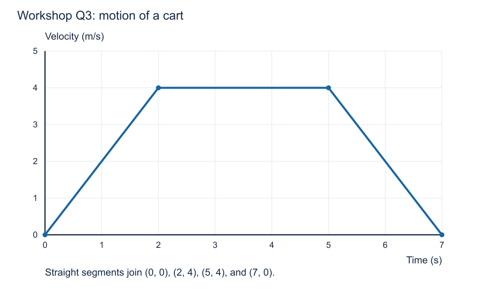

# Class 2 workshop: motion on paper, checked with Python

**Duration:** 90 minutes, including a five-minute break.  
**Name:** ____________________  **Date:** ____________________

Use your notebook or separate sheets for full working. Start each question independently, then compare reasoning with a partner when invited. Keep your original attempt and make corrections in a different colour. Today's calculator and learning formula card do not establish the rules for the final exam.

## Today's route

| Workshop time | Activity |
|---|---|
| 0–10 min | Q1–Q2: units and motion |
| 10–30 min | Q3–Q4: read and sketch graphs |
| 30–50 min | Q5–Q6: constant acceleration |
| 50–55 min | Break |
| 55–70 min | Q7: predict, change values, run, explain |
| 70–80 min | Q8: independent written practice |
| 80–90 min | Feedback and exit ticket |

## Learning formula card

For any interval: **Δx = x_final − x_initial**, **average velocity = Δx / Δt**, **average speed = total distance / Δt**, **average acceleration = Δv / Δt**.

For constant acceleration over an interval:

> v = v₀ + at  
> Δx = v₀t + ½at²  
> Δx = ½(v₀ + v)t  
> v² = v₀² + 2aΔx  
> x = x₀ + Δx

For constant velocity: **x = x₀ + vt**. Use **g = 9.81 m/s²** in free-fall questions, neglecting air resistance. Keep extra digits while calculating; normally report calculated answers to three significant figures unless the teacher specifies otherwise. Whole-number graph coordinates are exact model values for this activity.

**Written method:** givens and unknown → direction and sketch → SI units → equation and rearrangement → substitution → answer with units → check.

## Q1. Recover the units

Show conversion factors so the units cancel.

a. Convert 54 km/h to m/s.  
b. Convert 500 ms to s.  
c. A student writes an acceleration as “2 m/s.” Correct the unit and explain what an acceleration of +2 in the correct unit means.

## Q2. A robot changes direction

Right is positive. A robot starts at x = −2 m, moves 6 m right, then 2 m left. The whole journey takes 8 s.

a. Draw a number line with start, turning point, and finish.  
b. Find the final position, total distance, and displacement.  
c. Find average speed and average velocity over all 8 s.  
d. Explain why these two averages differ.

**If stuck:** label the three positions first. The origin is not necessarily the starting position.

## Q3. Read a velocity–time graph



*The cart moves along a straight line. Use the graph, showing each slope or area calculation.*

a. Describe the motion during 0–2 s, 2–5 s, and 5–7 s.  
b. Find the acceleration during each interval.  
c. Find the displacement over the whole 7 s by splitting the area into simple shapes.  
d. Find the total distance. Explain whether it equals the displacement here.  
e. Find the average acceleration over all 7 s. Does your answer mean the velocity was constant throughout?  
f. Find the instantaneous acceleration at t = 1 s and at t = 3 s.

**If you finish early:** find the average velocity over all 7 s. Explain why averaging the initial and final velocities would give the wrong answer.

## Q4. Sketch a position–time graph

A cart has the following positions. Between the listed points it moves with constant velocity.

| Time t (s) | 0 | 1 | 2 | 3 |
|---|---|---|---|---|
| Position x (m) | −1 | 2 | 5 | 8 |

a. Plot position against time. Label axes and units, and join the points.  
b. Calculate the velocity from the slope.  
c. Find the position and displacement from the start at t = 2 s.  
d. Sketch the corresponding velocity–time graph.  
e. A classmate says the speed at t = 2 s is 5 m/s because the position graph has height 5. Explain the mistake.

**If stuck:** calculate a change in position divided by a change in time.

## Q5. A robot accelerates

A robot starts at x₀ = 2.0 m and moves right with v₀ = +1.0 m/s. It accelerates at a constant +0.80 m/s² for 5.0 s.

a. Find its final velocity.  
b. Find its displacement and final position.  
c. Check the displacement using the average of the initial and final velocities. Explain why this check is valid here.  
d. Sketch the shapes of its position–time, velocity–time, and acceleration–time graphs. Include their starting and ending values.

**If stuck:** for part (b), calculate v₀t and ½at² separately before adding. Do not forget the initial position when finding x.

## Q6. Apply the source exercise: a landing aircraft

Adapted from **Physics Period1 Exer3, Question 5**. An aircraft touches down at 220 km/h and reaches rest 29 s later.

For this classroom model, assume constant acceleration along a straight runway, with braking beginning at touchdown. Find the **modelled stopping displacement after touchdown**. The original sheet calls this the shortest runway; our calculation describes only the stated simplified motion.

a. Convert the initial speed to m/s, retaining extra digits.  
b. Choose the direction of motion as positive and calculate acceleration.  
c. Calculate the stopping displacement.  
d. Sketch the velocity–time graph and use its area to check your answer.  
e. Explain why the acceleration is negative while the displacement is positive, and why this model should end at rest.

Write a complete solution that another student could follow.

## 50–55 minutes | Break

## Q7. Python as a calculator for your motion model

**15 minutes maximum.** Use the Python environment you already use in your programming class. Your teacher can run the example if a computer is unavailable. No installation, plotting package, or new programming structure is needed.

A variable is a named value. The symbol `=` stores a value in that name. Python uses `*` for multiplication and `** 2` for squaring. A line beginning with `#` is a comment. `print` displays a result.

### Predict on paper first — 4 minutes

Let x₀ = 0 m, v₀ = +2 m/s, a = +1 m/s², and t = 4 s. Predict final velocity, displacement, and final position. Sketch the direction and shape of the velocity–time line. Keep your prediction visible.

### Copy and run the whole supplied block — 4 minutes

```python
# Change only the numerical values in these first four lines.
initial_position = 0.0       # m
initial_velocity = 2.0       # m/s
acceleration = 1.0           # m/s^2
time = 4.0                  # s

velocity = initial_velocity + acceleration * time
displacement = initial_velocity * time + 0.5 * acceleration * time ** 2
position = initial_position + displacement

print("Velocity (m/s):", velocity)
print("Displacement (m):", displacement)
print("Position (m):", position)
```

This computes the exact constant-acceleration equations at one chosen time; it does not animate the motion.

### Change one value, then explain — 7 minutes

a. Predict what happens if acceleration becomes −1.0 m/s². Change only `acceleration = 1.0` to `acceleration = -1.0` and rerun the whole block. Record the output.  
b. Keep acceleration at −1.0 and change time to 2.0 s. Predict and run again. Record the output.  
c. Explain what happens between 0 and 2 s and between 2 and 4 s. Does negative acceleration always mean slowing down?  
d. Explain how the object can end at its starting position after 4 s without having stayed still.

Each person writes an explanation. If working in a pair, swap who changes the values after the first run. A matching output checks arithmetic; your explanation checks the physical interpretation.

## Q8. Independent written practice — 10 minutes

Work alone with the learning formula card. Do not use Python. This is a practice task, not a statement about permitted exam aids.

A cart moves right at 54 km/h. At the start of braking its position is x₀ = 10 m. It reaches rest after 5.0 s with constant acceleration.

a. Convert its initial speed to m/s.  
b. Calculate acceleration, including its sign.  
c. Calculate displacement during braking and final position.  
d. Sketch the velocity–time graph with labelled endpoints and units. Check the displacement using its area.  
e. State one assumption needed for your calculation.

Show the method even if you cannot finish the arithmetic. Your teacher will use a suggested 10-mark practice rubric.

## Feedback and exit ticket — 10 minutes

Use the first seven minutes to correct Q8 and explain one correction to a partner. Then answer these three prompts independently:

1. What do the slope and the signed area of a velocity–time graph represent?
2. If v = −2 m/s and a = −1 m/s², is the object speeding up or slowing down? Explain.
3. Write one step you will use to improve your next handwritten physics solution.

## Optional extensions or follow-up

These are not required within the 90-minute workshop.

### E1. A dropped rock

From **Physics Period1 Exer3, Question 3**: a rock is dropped from rest into a well, and a splash is heard 4.4 s later. As instructed in the original question, neglect sound travel time and treat 4.4 s as the fall time. Neglect air resistance.

Choose upward positive. Find the displacement, the depth of the water below the release point, and the rock's velocity just before impact. Explain the signs.

### E2. Distance when direction changes

Use Q7 with x₀ = 0, v₀ = +2 m/s, and a = −1 m/s² over 0–4 s.

Draw the velocity–time graph. Mark where it crosses zero. Calculate positive and negative signed areas separately, then find displacement and total distance. State velocity and acceleration at the turning point.

### E3. When time is not given

A cart initially moves right at 8.0 m/s and slows with constant acceleration −2.0 m/s² until it stops. Find its stopping displacement using an equation without time. Then find stopping time and check the displacement another way.

## Where these questions lead

Q3 builds the slope-and-area skills used in [Review Exercise 2](../course/exercises/Physics%20Period1%20ReviewExer.pdf). Q6 and E1 use the original [Exercise 3 sheet](../course/exercises/Physics%20Period1%20Exer3.pdf), which is labelled “Week 3” in the source course. We are selecting its 1D questions for our second class; the original numbering has not changed.
